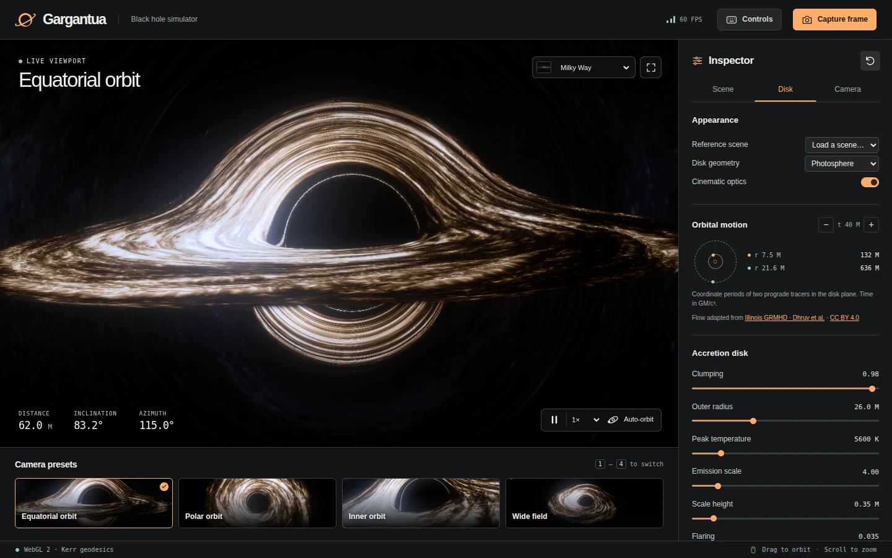
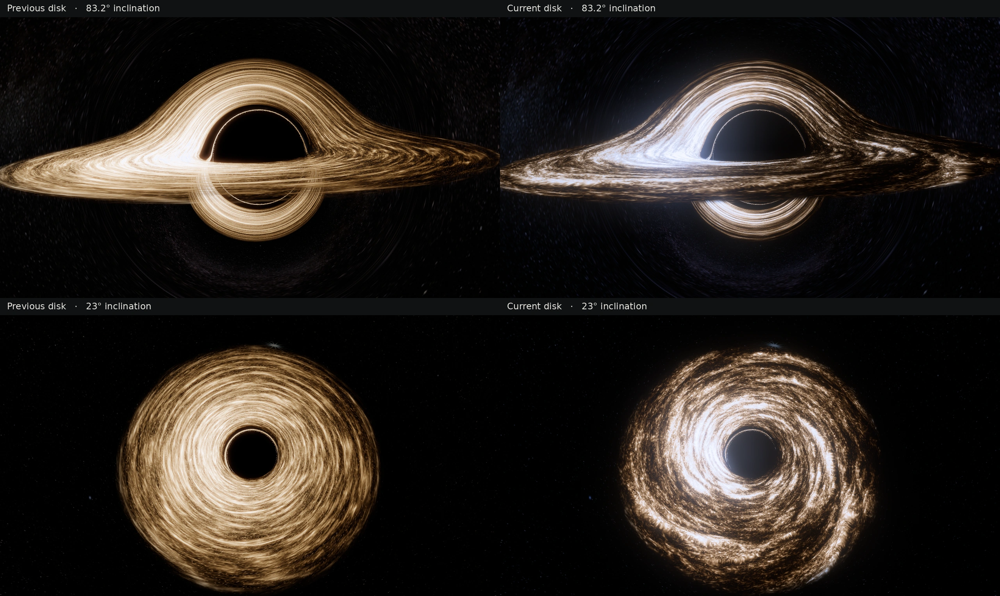

# Gargantua

Gargantua traces light around a rotating black hole in an interactive 3D viewer and a double-precision CUDA renderer. The disk uses a time series from a published magnetized accretion-flow simulation. Hold the camera still to see turbulent patches shear apart, or view the disk edge-on to see its far side bent into an arc above the shadow. Choose an all-sky survey, move the observer, or capture a full-resolution native exposure.



## Play

From the repository root, run

```bash
node play.mjs
```

The launcher displays a native Kerr render while it prepares the viewer. It opens the simulation once the sky, packaged plasma data and first frame are ready. It uses a standalone browser window when a supported Chromium browser is available. The first launch needs Node.js 18.19+, npm, and internet access to install the locked viewer dependencies. A WebGL 2 browser runs the interactive simulation. A compatible NVIDIA GPU and CUDA toolkit enable the native renderer. The launcher reuses current builds and prepares an updated native build on supported machines.

**Drag to orbit, scroll or pinch to zoom, and press H for an unobstructed view.** The **Capture frame** control saves the viewport or starts a native Kerr exposure. Press **?** for the complete control reference.

[Viewer controls and rendering modes](#interactive-viewer) · [Native renderer quick start](#quick-start) · [Numerical validation](#numerical-validation)

[Explore the disk at 8K](docs/gargantua-8k.webp) · [Watch the 1080p fixed-camera film](docs/orbiting-plasma.mp4) · [Watch a camera orbit](gargantua.mp4) · [View the original animation](gargantua.gif) · [Open the original HDR still](gargantua_real.hdr)

## Highlights

* **Kerr spacetime:** Boyer–Lindquist coordinates with geometric units `G = c = M = 1`.
* **Physical ray tracing:** backward null-geodesic integration in Hamiltonian form.
* **Adaptive RK4/5 integration:** Cash–Karp embedded solver with independent relative and absolute tolerances.
* **Coordinate-time integration:** every ray also evolves `t`, enabling light-travel-time-aware disk animation.
* **ZAMO observer frame:** the camera is initialized in a locally non-rotating orthonormal tetrad and naturally includes frame dragging.
* **Relativistic disk model:** the default radial flux profile is a normalized Novikov–Thorne / Page–Thorne profile with a zero-torque inner boundary at the disk inner edge.
* **Legacy disk mode:** the original analytic profile remains available for comparisons and film-inspired renders.
* **Independent frequency-shift controls:** kinematic Doppler shift and gravitational redshift can be enabled or disabled separately.
* **Fluid-frame volumetric path length:** emission and opacity use the local `-k_mu u^mu dλ` factor instead of a coordinate-space distance estimate.
* **Turbulent plasma** follows a log-normal heating cascade: recorded GRMHD structure at large scales, compressed by radiative diffusion, and sheared, finite-lifetime eddies below the grid that wind with the exact Kerr Ω(r). The direct disk and its lensed images sample the gas at different emission times.
* **Real black holes:** Phoenix A\*, TON 618, M87\*, Sagittarius A\*, Gaia BH3, Cygnus X-1, V404 Cygni and Gaia BH1. Disk temperatures follow from mass, spin and Eddington ratio, companion stars appear at their measured angular size, and each object opens on its most striking views.
* **Event Horizon Telescope mode:** a hot, magnetized flow imaged at 230 GHz with thermal synchrotron emission and self-absorption, a plunging inner flow, an optional jet sheath and an orbiting flare.
* **Scenarios:** a body falling into a Kerr black hole (redshift, frozen image, time dilation, tides, and a ride-along view) and a binary black-hole merger with live gravitational-wave plots.
* **Optically thick photosphere** traces the visible face of a flared disk and its orientation in the fluid frame. A partially covered thin sheet and an emitting and absorbing volume are also available.
* **Relativistic color:** observed temperature follows the local frequency shift and is converted through Planck spectra and CIE 1931 color matching.
* **Lensed real sky maps:** Radiance HDR and binary PPM equirectangular maps are sampled using escaped ray directions.
* **Camera response** offers direct tone mapping or cinematic highlight roll-off and lens scattering. Radiance HDR captures store the linear exposure.
* **Numerical diagnostics:** the renderer reports normalized RK error, rejected steps, and forced minimum-step accepts.
* **Physics regression tests:** horizon radius, ISCO, nullness, Hamiltonian conservation, Carter-constant conservation, coordinate-time evolution, and the Schwarzschild critical capture boundary are covered by CTest.
* **Interactive viewer:** WebGL lensing, adaptive resolution, orbital camera controls, and optional CUDA refinement all use the same observer pose.

## Requirements

| Component | Requirements |
| --- | --- |
| Interactive viewer | Node.js 18.19+, npm, a browser with WebGL 2, and graphics acceleration |
| Native CUDA rendering | NVIDIA CUDA-capable GPU, compatible driver and CUDA toolkit, CMake 3.20+, and a C++17 host compiler |
| PNG compression | Optional zlib at configure time. A built-in PNG writer is available on every build. |
| MP4 orbit encoding | Optional ffmpeg |

## Build

From the repository root:

```bash
cmake -S . -B build -DCMAKE_CUDA_ARCHITECTURES=89
cmake --build build -j
```

Replace `89` with the compute capability for your target GPU. For example, use the architecture appropriate to your installed CUDA toolkit and GPU. With CMake 3.24 or newer, the project defaults to `native` when no architecture is supplied. Earlier CMake versions use the compiler’s architecture selection.

The default build intentionally **does not** enable CUDA `--use_fast_math`, which makes it more suitable for numerical validation.

### Run the physics tests

```bash
ctest --test-dir build --output-on-failure
```

Tests are built by default. Disable them with:

```bash
cmake -S . -B build \
  -DCMAKE_CUDA_ARCHITECTURES=89 \
  -DGARGANTUA_BUILD_TESTS=OFF
```

### Optional fast-math build

After validating your configuration, you can build a faster version with CUDA fast math:

```bash
cmake -S . -B build-fast \
  -DCMAKE_CUDA_ARCHITECTURES=89 \
  -DGARGANTUA_FAST_MATH=ON
cmake --build build-fast -j
```

Fast math can change floating-point behavior, so use the default build for accuracy comparisons and regression testing.

## Quick Start

Render the default 1920 × 1080 photosphere at four samples per pixel:

```bash
./build/gargantua
```

Render a higher-quality frame with the included Milky Way map and linear HDR output:

```bash
./build/gargantua \
  --width 1920 \
  --height 1080 \
  --spp 16 \
  --spin 0.99 \
  --disk-model nt \
  --starmap milkyway.ppm \
  --sky-bright 1.3 \
  -o gargantua_real.png \
  --hdr gargantua_real.hdr
```

For stricter ray integration:

```bash
./build/gargantua \
  --tol 1e-8 \
  --atol 1e-11 \
  --min-step 1e-8 \
  --max-step 1.0 \
  --spp 16 \
  -o precise.png
```

The renderer reports the maximum normalized RK error, rejected steps, forced accepts and unfinished rays. It also counts sky rays that needed the finite-radius fallback. A forced accept means a finite trial reached `--min-step` before meeting the requested tolerance. An unfinished ray exhausted its integration budget or failed to produce a valid next state. Its pixel retains the light accumulated along the valid portion of the path.

## Disk Models

### Novikov–Thorne / Page–Thorne — default

```bash
./build/gargantua --disk-model nt
```

The renderer builds a host-side relativistic radial flux table for prograde equatorial circular orbits in Kerr spacetime. The table is normalized to unit peak flux and sampled on the GPU.

With this model:

```text
T_eff(r) = disk_temp * F(r)^(1/4)
```

so `--disk-temp` represents the **peak effective temperature**, not the temperature exactly at the ISCO. The flux goes to zero at the no-torque inner boundary.

### Legacy profile

```bash
./build/gargantua --disk-model legacy
```

This retains the original analytic profile for compatibility, visual comparisons, and stylized renders.

## Frequency Shifts

By default, Gargantua applies both gas-motion Doppler effects and gravitational frequency shift.

Disable only the gas-motion term:

```bash
./build/gargantua --no-kinematic-doppler
```

The old option remains as a compatibility alias:

```bash
./build/gargantua --no-doppler
```

Disable gravitational redshift separately:

```bash
./build/gargantua --no-redshift
```

This separation is useful for visualizing how much of the disk asymmetry comes from orbital motion versus gravitational frequency shift.

For thermal emission, conservation of `I_ν/ν³` transforms an emitted Planck spectrum into a Planck spectrum at `T_obs = g * T_emit`. The renderer integrates that spectrum from 380 to 780 nm with CIE color matching functions. A single reference luminance at the configured peak disk temperature sets the exposure scale. The cooler outer disk fades as its emission moves into the infrared. [Relativistic transfer](https://arxiv.org/abs/1602.03184) · [CIE color matching fits](https://jcgt.org/published/0002/02/01/)

### Escaping sky rays

Once an outward ray has cleared the disk, the Kerr radial potential and its derivatives establish whether it can turn again. Rays with a black background can finish at that point. For a mapped sky, the renderer advances the remaining vacuum path to infinity using inverse radius, `u = 1/r`. Two radial quadratures supply the Mino-time interval and frame-dragging angle. A Cartesian angular integration avoids a coordinate singularity at the poles. Refinement uses the requested ray tolerance. The finite-radius affine path is available if the compact solver cannot resolve an arc. [Separated Kerr photon equations](https://arxiv.org/abs/0903.0620)

## Orbiting Plasma

Large-scale brightness fluctuations come from 32 consecutive snapshots of the Illinois v3 SANE accretion flow at prograde spin `a/M = 0.5`. The dumps cover 155 gravitational time units with one sample every 5 M. The renderer samples the field in radius, azimuth and emission time at each ray hit. The data supply both orbital advection and changes in the shape and strength of individual structures. [Simulation library and methods](https://doi.org/10.3847/1538-4365/adaea6) · [Source data, license and derivation](src/flow/README.md)

The measured magnetic and thermal pressure variations modulate a prescribed radial heat flux. An optically thick photosphere radiates the vertically integrated dissipation after radiative diffusion, which smooths the midplane contrast (log-scatter ≈ 0.87 in the packaged data). The renderer therefore raises the recorded activity to a power β = 0.7 × clumping and renormalizes it with the measured statistics, E[A^β] = exp(−0.437 β(1 − β)). Below the 128-cell grid, four octaves of anisotropic gradient noise represent the turbulent cascade (rms ∝ ℓ^5/6, lifetime ∝ ℓ^2/3). Each octave lives in the comoving frame of overlapping logarithmic radial bands. A generation of eddies is born with a 1.5:1 azimuthal aspect, wound by the exact local Kerr angular velocity, and replaced every 0.2 local orbits through a variance-preserving cross-fade. The resulting heating is log-normal with unit mean, so the radial flux law is preserved. Its width is 0.5 × clumping. Eddies smaller than a pixel fade to their mean rather than alias. The default clumping of 0.5 gives a photospheric flux scatter of about 40%, comparable to radiation-MHD disk simulations. The input flow is radiatively inefficient, while the displayed optical spectrum uses a thermal disk and a user-selected peak temperature. Changing the spin changes the geodesics, ISCO, radial flux and orbital timing. The same underlying set of turbulent fluctuations supplies the texture at other spins.



The camera follows its past light cone. Each ray starts with unit frequency in the local camera frame and accumulates negative coordinate time toward the emitting gas. The disk is evaluated at `observer_time + ray_time`, so the direct image and its lensed arcs can show different phases of the same orbit. The fast Schwarzschild viewer obtains its travel times from the spherical null-orbit tables. [Hot spots and their relativistic images](https://arxiv.org/abs/astro-ph/0309458)

**Clumping** sets the width of that log-normal heating distribution. The data are normalized in radial annuli. Higher local heating raises the emitted temperature (T ∝ heating^1/4) and changes the visible color before gravitational redshift, Doppler shift and camera processing.

Set the observer's Boyer–Lindquist coordinate time with `--time T` in units of `GM/c³`. For animations, frame number `i` has time `T + i * frame_dt`, with frame numbers starting at zero. The default is `--time 0 --frame-dt 1`. Use `--frame-dt 0` for a simultaneous snapshot from multiple camera positions.

Freeze the pattern in coordinate time with:

```bash
./build/gargantua --static-disk-pattern
```

This freezes both the simulated pattern and the smaller-scale material in coordinate time.

## Disk Geometry

The native renderer and the viewer open with the photosphere (CLI flag `--photosphere`). The outer column thins gradually to a transmitting atmosphere. Rays strike the near face of a flared, optically thick disk. This lets the foreground gas hide part of the far-side image at grazing inclination. The local viewing angle in the fluid frame sets the angular emission through a flux-normalized limb-darkening law. **Scale height** and **Flaring** control the surface in the Disk inspector. [Limb darkening in relativistic disk images](https://adsabs.harvard.edu/pdf/1990MNRAS.242..560L)

Select **Thin sheet** (`--thin`) for a partially covered equatorial emitter, or **Emitting volume** (`--volume`) to integrate emission and absorption through a Gaussian vertical column. In the volume, the small-scale model includes vertical oscillations at the Kerr epicyclic frequency. The gas frequency shift uses a circular-orbit velocity prescription. [Kerr orbital and epicyclic frequencies](https://doi.org/10.1093/mnras/stv1120)

The volumetric path uses the local fluid-frame photon frequency factor

```text
-k_mu u^mu dλ
```

for the optical-depth/emission path. The formal emission solution also handles the optically thin `disk_absorption -> 0` limit correctly.

The native solver integrates the smooth Gaussian column along an accepted segment and samples its local plasma distribution. In the volume, clumping changes both the emitting column and local heating.

## Interactive Viewer

The launcher binds to the loopback interface and prints the viewer URL. Close the terminal process with **Ctrl+C**. To choose a port, use a custom compiled renderer, or run the viewer without opening a window, use

```bash
node play.mjs --no-open
node play.mjs --web-only
RENDER_API_PORT=8787 GARGANTUA_BIN=/absolute/path/to/gargantua node play.mjs
```

The sky selector in the viewport switches among the Milky Way, a deep star field, WISE infrared, Fermi gamma rays and dark sky. Each choice also applies to native captures. **Scene** controls spin, exposure, sky brightness, and relativistic frequency shifts. **Disk** controls clumping, emissivity, the radial flux model and disk geometry. Its **Orbital motion** diagram follows two representative fluid orbits in the source plane and shows their radii and periods. The playback selector beside Pause runs at 3, 12 or 36 units of `GM/c³` per real second. Leave **Auto-orbit** off to watch the gas with the stars and shadow fixed.

The opening view uses the source simulation’s spin of 0.5, a radial peak of 5600 K and a camera inclination of 83.2°. The film preset places the camera at 86.5° and exposes the fainter lensed arcs more strongly. Both the opening view and **Disk → Film-inspired** include the Doppler and gravitational frequency shifts. The approaching side can brighten to white while the far side and the cooler outskirts retain color. **Cinematic optics** redistributes a fraction of the light over three angular scales and compresses bright highlights for a display. Colors stay in linear sRGB with its D65 white and no chromatic adaptation toward the disk, so cooler thermal gas keeps its orange-red hue. Disable it to inspect the direct tone-mapped exposure, or save the linear HDR from CUDA. **High spin** selects a hotter volume with direct tone mapping. **Camera** controls roll, observer radius, polar inclination, azimuth and vertical field of view. [Film camera and lensing study for *Interstellar*](https://doi.org/10.1088/0264-9381/32/6/065001)

The **−** and **+** controls beside the orbital clock pause playback and step observation time backward or forward by 5 M. Use the same setting and observation time to return to a feature or to capture it in CUDA.

| Control | Action |
| --- | --- |
| Drag or one-finger swipe | Orbit around the black hole |
| Wheel or two-finger pinch | Change observer distance |
| Arrow keys, + and − | Orbit and zoom while the viewport has focus |
| 1–4 | Switch between equatorial, polar, inner, and wide camera presets |
| Space / O | Pause animation / toggle automatic orbit |
| [ / ] | Step the observer clock backward / forward by 5 M |
| H / F | Toggle focus view / fullscreen |
| C / ? | Open capture / show controls |
| Standard gamepad | Left stick orbits, triggers zoom, A pauses, RB cycles presets, and Y toggles focus |

**Live viewport.** Under **Light paths**, Kerr traces rotating-spacetime null geodesics in the fragment shader with a finite-radius ZAMO observer, frame dragging, redshift, and retarded disk emission. It uses single precision and a bounded RK4 integration. The faster Schwarzschild mode uses tables of spherical null trajectories and applies spin to the disk’s ISCO, orbital motion, and flux profile. The status bar names the active model. Automatic starts in Kerr on hardware and selects Schwarzschild after three sustained low-frame-rate measurement windows. Recognized software rasterizers start in Schwarzschild at half the linear sampling resolution. Choose Kerr explicitly to keep its physics at every frame rate.

**Quality.** Adaptive starts above one ray per CSS pixel on a standard desktop display and adjusts to measured frame time and device limits. Pausing lets a stationary view sharpen to double the linear sampling resolution, within an 8.3-megapixel budget. High keeps supersampling active during motion. Performance limits the drawing buffer. Hover over the frame-rate indicator for its current dimensions. The live disk uses simplified transfer. Near-critical paths and higher-order disk images benefit from a converged native render.

**Kerr still on idle.** Enable this under **Viewport** to trace the stationary observer with the double-precision native solver. The first pass delivers a one-sample preview. Adaptive follows with six samples per pixel up to 2560 × 1440, and High follows with twelve up to 3840 × 2160. Both passes use the same camera event and aspect ratio. Performance keeps the quick pass. Moving the camera immediately returns to live rendering and cancels obsolete work.

**Capture frame.** Save the viewport as a PNG, or choose a native size and **Render PNG**. Native captures default to 3840 × 2160 at twelve samples per pixel. The size menu offers 1080p, 4K, 8K and custom dimensions. The maximum is 7680 × 4320 in landscape or 4320 × 7680 in portrait, at up to 64 samples per pixel. The CUDA renderer traces high-resolution frames in strips using absolute pixel coordinates. A nonzero **Shutter (M)** distributes the samples across the exposure. Previews use an instantaneous sample. Explicit captures appear in `viewer/renders/`. The native CLI can also export linear HDR data.

For frontend development run

```bash
npm --prefix viewer ci
npm --prefix viewer run dev
```

Vite prints the development URL and proxies the local API. Two draw-on-demand pages help with look development and also work in a background tab: `/tests/lookdev.html?object=m87&view=1` renders any catalog view or setting, and `/tests/scenario.html?id=infall&time=40` renders a scenario frame. The standalone production bundle is built with `npm --prefix viewer run build`. All backgrounds are bundled locally. [Sky map details and credits](skies/SOURCES.md)

## Real Black Holes

Choose **Black holes** in the top bar to open a catalog of measured objects. Each card loads literature parameters and its most striking views. The **Object** tab lists the measurements, references and the physical scales that follow from mass and spin: gravitational radius, horizon, the time unit GM/c³, the ISCO and its orbital period, the Eddington luminosity, the tidal stretch across a 2 m body at the horizon and, for nearby objects, the shadow's angular diameter from Earth.

| Object | Mass (M☉) | What the views show |
| --- | --- | --- |
| Phoenix A\* | ~1 × 10¹¹ (indirect) | A horizon ~2,000 AU across with negligible tides. At 0.5% Eddington the disk peaks near 10,000 K and glows in visible light. |
| TON 618 | 6.6 × 10¹⁰ | A 5%-Eddington quasar disk running from ~20,000 K blue-white to deep orange in its outskirts |
| M87\* | 6.5 × 10⁹ | The EHT 2017 view at 230 GHz, 17° from the jet axis, with the southern side brightened by beaming. A wider view shows the jet sheath. |
| Sagittarius A\* | 4.3 × 10⁶ | The EHT 2022 ring at 230 GHz and an orbiting flare at 9 M, about one hour per orbit |
| Gaia BH3 | 32.7 | A dormant hole that lenses its metal-poor giant companion into an Einstein ring |
| Cygnus X-1 | 21.2 | Spin a > 0.9985, a ~10⁷ K disk that looks blue-white in visible light, and its supergiant companion filling ~50° of the sky |
| V404 Cygni | 9.0 | A thick, flaring near-Eddington outburst disk with its K-giant companion |
| Gaia BH1 | 9.62 | The nearest known black hole, lensing its Sun-like companion into a ring |

Thin-disk temperatures are not hand-tuned. The Page–Thorne flux in units of Ṁc²/r_g² gives the peak effective temperature for the object's mass, spin and Eddington ratio. The color temperature includes the Done et al. (2012) spectral hardening, and the disk is a diluted blackbody f⁻⁴B(fT), so companions are lit on the same radiometric scale. Unknown spins are labelled as assumptions. Companion stars lie ~10⁶–10⁷ M away and are rendered on the celestial sphere at their measured angular radius and temperature, with limb darkening.

## Event Horizon Telescope Mode

M87\* and Sagittarius A\* accrete far below the Eddington rate through hot, optically thin flows that radiate at millimetre wavelengths. Their catalog views switch the Kerr ray tracer to a 230 GHz synchrotron image, displayed as brightness temperature with the EHT-style color map.

* Self-similar profiles following Broderick et al. (2011): n_e ∝ r^−1.1 with an angular scale height, T_e ∝ r^−0.84, and a magnetic field from a plasma β.
* The Mahadevan, Narayan & Yi (1996) angle-averaged thermal synchrotron emissivity with Kirchhoff self-absorption.
* Gas on Keplerian shells outside the ISCO and on the ballistic ISCO plunge inside it. The frequency shift includes the radial velocity.
* An optional limb-brightened parabolic jet sheath with a relativistic outflow, and an orbiting Gaussian flare sampled at each ray's retarded time.

The mass sets the physical path lengths, and the transfer uses the invariant g³ j_ν(ν/g) and the frame-invariant optical depth. This mode is WebGL-only; native captures trace the thermal disk.

## Scenarios

Choose **Scenarios** in the top bar.

**Falling into a black hole.** A thermally glowing dust body follows an exact Kerr timelike geodesic, integrated in Mino time so it passes regularly through the horizon. It is rendered inside the ray tracer at each ray's retarded emission time. A distant camera sees it slow, redden as T_seen = gT and fade exponentially, with the late-time decay set by the surface gravity κ. Its image freezes at the horizon and co-rotates at the horizon's angular velocity. A beacon flashes at fixed intervals of the body's proper time. The geodesic-deviation equation with the Kerr tidal eigenvalues stretches it radially and squeezes it transversely. The plots compare radius against coordinate time and proper time, show the received frequency ratio, and give the tidal acceleration across a 2 m body for the mass of any catalog object: about 10⁻³ m/s² at Sagittarius A\*'s horizon, ~10⁷ g at Gaia BH1's. **Ride along** boosts the camera into the body's frame, showing the aberrated, Doppler-shifted sky until Boyer–Lindquist time ends just outside the horizon.

**Binary black-hole merger.** Effective-one-body dynamics with the TEOBResumS aligned-spin Hamiltonian, including its numerical-relativity-calibrated terms. Radiation reaction uses the Damour–Iyer–Nagar factorized flux summed over all modes with l ≤ 4. The (2,2) merger matches the peak amplitude and frequency fits of Healy & Lousto (2018). The Backwards-One-Body ringdown is driven by the remnant's quasi-normal modes, which Leaver's continued-fraction method computes exactly. Remnant mass, spin and recoil come from published NR fits. The 3D view traces light through the superposed fields of the two moving holes, each ray seeing them at its own retarded time, with an optional overlay of the outgoing h₊ wave field. The plots show the strain at Earth, a LIGO-style time–frequency map, the separation, and the gravitational-wave luminosity in watts. Presets include GW150914, GW190521 and GW190814. See [the merger notes](viewer/src/scenarios/merger/README.md) for the formulation, validation and approximations.

## Animation

To animate just the disk, fix the observer and advance simulation time between frames. These 96 frames play for four seconds at 24 fps.

```bash
./build/gargantua --frames 96 --fixed-camera --anim-dir plasma-frames \
  --width 1920 --height 1080 --spp 6 --time 0 --frame-dt 1 --shutter .45 \
  --photosphere --min-step 1e-10 --starmap milkyway.ppm --sky-bright .12 --cinematic
ffmpeg -framerate 24 -i plasma-frames/frame_%04d.png -c:v libx264 -preset medium -crf 16 -pix_fmt yuv420p -movflags +faststart plasma.mp4
```

The repository includes a shell helper for rendering an orbit and encoding it with `ffmpeg`:

```bash
./render_animation.sh 240 1920 1080 12 30
```

Arguments are:

```text
frames width height spp fps
```

You can also render a sequence directly in one renderer process:

```bash
./build/gargantua \
  --frames 120 \
  --anim-dir frames \
  --width 1280 \
  --height 720 \
  --spp 4 \
  --cam-theta 86 \
  --orbit-theta-amp 5 \
  --orbit-r0 70 \
  --orbit-r1 46 \
  --starmap milkyway.ppm
```

Animation mode reuses GPU allocations, the blackbody lookup table, the disk flux table, and the uploaded star map across frames.

## Command-Line Reference

```text
--width N                  image width
--height N                 image height
--spp N                    samples per pixel

--spin A                   Kerr spin a/M in [0,1)

--cam-r R                  camera radius in M
--cam-theta DEG            camera polar angle; 90 = equatorial
--cam-phi DEG              camera azimuth
--time T                   observer coordinate time in M (default 0)
--shutter T                exposure duration in M centered on observer time (default 0)
--fov DEG                  horizontal field of view
--yaw DEG                  local camera yaw offset
--pitch DEG                local camera pitch offset
--roll DEG                 image-plane camera roll (default −2 degrees)

--disk-in R                inner disk radius; <0 = prograde ISCO
--disk-out R               outer disk radius
--disk-temp K              peak effective temperature
--disk-bright X            emission scale
--disk-noise X             strength of local accretion-flow structure, 0..1
--disk-model nt|legacy     radial disk flux model
--disk-thick X             disk scale height in M
--disk-flare X             scale-height flaring
--disk-absorb X            opacity coefficient
--photosphere              trace the opaque, flared emitting surface (default)
--thin                     use an equatorial emitting surface with partial coverage
--volume                   integrate through the emitting and absorbing gas
--no-disk                  hide the accretion disk

--no-kinematic-doppler     disable gas-motion Doppler term
--no-doppler               compatibility alias
--no-redshift              disable gravitational frequency shift
--static-disk-pattern      freeze the turbulent pattern in coordinate time

--starmap FILE             equirectangular HDR/PPM background
--sky-bright X             background brightness scale
--companion TH PH R T      companion star on the sky: direction (deg), angular radius (deg), T_eff (K)
--disk-color-correction F  disk spectral hardening; the disk radiates f^-4 B(f T)

--tol X                    RK relative tolerance
--atol X                   RK absolute tolerance
--min-step X               minimum affine step
--max-step X               maximum affine step
--max-iter N               per-ray integration step cap

--exposure X               linear exposure before tone mapping
--cinematic                simulate lens scattering and a film highlight shoulder in PNG output
-o FILE                    output PNG
--hdr FILE                 optional linear Radiance HDR output

--frames N                 render an animation sequence
--fixed-camera             keep the supplied camera pose throughout the sequence
--frame-dt T               coordinate time between animation frames in M (default 1)
--anim-dir DIR             animation frame output directory
--orbit-r0 R               animation camera-radius start
--orbit-r1 R               animation camera-radius end
--orbit-theta-amp DEG      animation inclination oscillation amplitude

-h, --help                 show current defaults
```

Run:

```bash
./build/gargantua --help
```

for the authoritative defaults compiled into the current `RenderConfig`.

## Physics and Rendering Model

| Area                    | Implementation                                                                  |
| ----------------------- | ------------------------------------------------------------------------------- |
| Spacetime               | Kerr metric in Boyer–Lindquist coordinates                                      |
| Units                   | `G = c = M = 1`                                                                 |
| Ray path                | Backward null-geodesic integration                                              |
| State                   | `(r, theta, phi, p_r, p_theta, t)`                                              |
| Conserved momenta       | `p_t` and `p_phi`                                                               |
| Geodesic equations      | Analytic derivatives of the separated Kerr Hamiltonian                          |
| Integrator              | Adaptive Cash–Karp embedded RK4/5                                               |
| Error control           | `atol + rtol * scale`                                                           |
| Camera                  | ZAMO locally non-rotating tetrad                                                |
| Horizon                 | `r+ = 1 + sqrt(1 - a^2)`                                                        |
| Default disk inner edge | Prograde equatorial ISCO                                                        |
| Default radial flux     | Normalized Novikov–Thorne / Page–Thorne profile                                 |
| Legacy radial flux      | Original analytic zero-torque-style profile                                     |
| Thick disk density      | Flared Gaussian profile with log-normal turbulent heating                        |
| Thick disk path         | Fluid-frame factor `(-k_mu u^mu) dλ`                                            |
| Photosphere             | First visible intersection with the two-sided flared surface, fluid-frame limb darkening |
| Thin disk               | Refined equatorial crossing inside `[r_in, r_out]`                              |
| Disk motion             | Prograde circular Kerr angular velocity                                         |
| Time dependence         | Recorded magnetized flow and sheared turbulent eddies at retarded emission time  |
| Millimetre mode         | Thermal synchrotron with self-absorption through a RIAF, plunge, jet and flare   |
| Physical units          | Mass-dependent lengths and times; Page–Thorne T_eff from M, a and Ṁ/Ṁ_Edd        |
| Frequency shift         | Independent kinematic and gravitational terms                                   |
| Color                   | Planck spectrum + analytic CIE 1931 color matching LUT                          |
| Sampling                | Per-pixel low-discrepancy jitter                                                |
| Background              | Equirectangular HDR/PPM sky sampled by escaped ray direction                    |
| SDR output              | Direct or cinematic response, sRGB encoding and TPDF dithering                  |
| HDR output              | Linear Radiance `.hdr`                                                          |

## Numerical Validation

The test executable checks several invariants and known Kerr/Schwarzschild results:

* Schwarzschild horizon radius `r+ = 2M`
* Kerr outer-horizon radius for `a = 0.9`
* Schwarzschild ISCO `r_ISCO = 6M`
* Prograde Kerr ISCO for `a = 0.9`
* Initial photon nullness
* Hamiltonian conservation along an integrated ray
* Carter-constant conservation
* Accepted normalized RK error staying within the requested tolerance
* Past-directed camera rays, frame-dragging direction, and forward-propagation time
* Approaching and receding Doppler factors and gravitational shift at finite camera radius
* Equatorial event localization and invariance of RK error under time and azimuth offsets
* The Novikov–Thorne flux against a closed-form Schwarzschild reference
* Visible-band color lookup against direct Planck photometry
* Sky directions against independent affine trajectories to one million gravitational radii, including polar turns
* Capture below and escape above the Schwarzschild critical impact parameter `b_c = 3 sqrt(3) M`
* Both prograde and retrograde Kerr equatorial capture boundaries, plus the near-extremal capture surface
* Turbulent eddies advected at the local Kerr rate, unit variance, unit-mean log-normal heating of the calibrated width, sub-pixel averaging, azimuthal periodicity, and continuity through eddy renewals (including the generation wrap at negative retarded times) and across radial bands
* Binary merger (`npm --prefix viewer test`): exact Schwarzschild quasi-normal modes and Kerr modes against tables, EOB binding energy and flux against 3PN and 3.5PN, the inspiral rate against TaylorT4, the equal-mass peak amplitude, frequency and luminosity, an energy balance between the integrated waveform flux and the NR fit, final spin 0.6865, GW150914 timing (ringdown ≈ 252 Hz, 4.1 ms) and strain, and the orbital hang-up for aligned spins
* Infall geodesics: proper time to the horizon and to the singularity against the analytic Schwarzschild results, four-velocity normalization along an inclined Kerr plunge, the late-time redshift rate set by the surface gravity, co-rotation at the horizon angular velocity, and a traceless tidal tensor equal to −2M/r³ at the horizon
* GRMHD atlas dimensions, annular flux, independent upper/lower surfaces, phase continuity and intrinsic evolution
* Photosphere intersections, double crossings, the settling outer edge, transmission and fluid-frame limb normalization

Run all tests with:

```bash
ctest --test-dir build --output-on-failure
```

These tests are intended to catch numerical regressions. They do not make the accretion-flow emission model a complete astrophysical plasma simulation.

In a volume convergence check, a camera at 18 M viewed a disk with spin 0.985, height 0.045 M and clumping 0.92 at time 19 M. At 480 × 270 and two samples per pixel, tightening the maximum affine step from 2 M to 0.0125 M changed the visible pixels by an average of 0.44 channel levels on the 0–255 scale at 88° inclination and 0.16 at 20°. The 99th-percentile differences were three and two levels, respectively.

The browser regression compares 14 silhouettes against independent finite-observer shadow boundaries. It includes equatorial and near-polar camera positions at 48 M and a quarter-turn of the observer’s camera. The largest measured discrepancy on the tested NVIDIA hardware was 0.622 pixels at 900 × 500. The same test advances the disk from a fixed camera and checks that paused and static material remain pixel-stable in both live lensing modes.

```bash
npm --prefix viewer test              # Local API, cancellation and capture delivery
npm --prefix viewer run test:lensing  # Installed Chromium, Chrome or Edge
```

Set `CHROME_BIN` to select the browser executable or `GARGANTUA_TEST_SOFTWARE=1` to exercise SwiftShader.

## Star Maps and Assets

Use `--starmap` with a 2:1 equirectangular all-sky image. Bundled native choices are `milkyway.ppm`, `starmap.ppm`, `skies/infrared.ppm` (WISE) and `skies/gamma-ray.ppm` (Fermi). Omit the option for a dark sky. The NASA survey panoramas use their published false colors, while the disk continues to emit visible thermal light. [Image sources, projection, and credits](skies/SOURCES.md)

Supported formats:

* **Radiance HDR** (`.hdr` / `.pic`) — linear high-dynamic-range radiance
* **Binary PPM** (`.ppm`, P6) — 8-bit sRGB converted to linear RGB on load

Example:

```bash
./build/gargantua \
  --starmap milkyway.ppm \
  --sky-bright 1.3 \
  --spp 8 \
  -o milkyway_lensed.png \
  --hdr milkyway_lensed.hdr
```

If no star map is provided, escaped rays see a black background.

## Example Looks

### Film-inspired view

A camera 3.5° above the disk plane resolves the thin foreground lane between the upper and lower lensed arcs. The hotter approaching gas is Doppler-brightened. The photographic exposure lifts the receding side while retaining the asymmetry.

```bash
./build/gargantua \
  --spin .5 --cam-r 66 --cam-theta 86.5 --cam-phi 52 --fov 46.22623 --roll -1 \
  --photosphere --cinematic --disk-temp 5400 --disk-bright 10 --disk-noise .98 \
  --disk-out 25 --disk-thick .25 --disk-flare .025 --spp 16 \
  --starmap milkyway.ppm --sky-bright .075 -o gargantua_film.png
```

### High-spin physical configuration

```bash
./build/gargantua \
  --spin 0.99 \
  --cam-theta 85 \
  --disk-model nt \
  --disk-temp 12000 \
  --spp 16 \
  --starmap milkyway.ppm \
  -o gargantua_physical.png \
  --hdr gargantua_physical.hdr
```

## Project Layout

```text
include/config.h
    Shared renderer configuration and disk-model selection.

src/main.cu
    CLI parsing, validation, still rendering, and animation setup.

src/render.h
    Host renderer API declarations.

src/render_kernel.cu
    CUDA ray tracing, disk transfer, frequency shifts, diagnostics,
    frame rendering, and GPU resource management.

src/spacetime.cuh
    Kerr metric, Hamiltonian geodesic equations, coordinate time,
    adaptive Cash-Karp stepper, ZAMO tetrad, Hamiltonian/Carter helpers,
    horizon radius, and ISCO.

src/celestial_sphere.cuh
    Outgoing Kerr vacuum propagation to the celestial sphere at infinity.

src/disk_profile.h
    Host-side Novikov-Thorne / Page-Thorne relativistic flux table.

src/flow/
    Packaged GRMHD movie, source credits, and the shared emission-time sampler.

src/disk_turbulence.inl, src/disk_turbulence.cuh
    Sheared, finite-lifetime turbulent cascade and log-normal heating shared by CUDA and WebGL.

src/photosphere.cuh, src/photosphere.inl
    Surface intersections, limb darkening and the tapered outer atmosphere.

src/disk_material.cuh, src/disk_column.cuh
    Surface covering and volume emission, plus Gaussian column integration.

src/film_response.inl
    Shared highlight response for the live viewer and cinematic CUDA output.

src/blackbody.cuh
    Planck/CIE color lookup table, tone mapping, and quantization.

src/starfield.cuh
    Equirectangular CUDA texture sampling plus hashing/noise helpers.

src/star_map.h
    Radiance HDR and PPM sky-map loaders.

src/png_writer.h
    PNG writer with optional zlib compression and a dependency-free fallback.

src/hdr_writer.h
    Radiance HDR writer.

src/vec_math.cuh
    Vector helpers and selectable geodesic precision type.

tests/physics_tests.cu
    Numerical Kerr/Schwarzschild regression tests.

viewer/
    WebGL lensing shaders, orbit camera, capture interface and local CUDA render API.

viewer/src/astro.ts, viewer/src/blackHoles.ts, viewer/src/catalogPanel.ts
    Physical units, Novikov-Thorne temperatures, the catalog of real black holes and its panel.

viewer/src/synchrotronShader.ts
    230 GHz thermal synchrotron transfer through a hot flow, jet sheath and flare.

viewer/src/scenarios/
    Scenario framework, the infall scenario and the binary black-hole merger.

render_animation.sh
    Batch animation and ffmpeg helper.
```

## Precision and Performance Notes

Geodesic calculations use `double` by default through:

```cpp
using real = GARGANTUA_REAL;
```

Consumer GPUs run FP64 at a small fraction of the FP32 rate. The build also produces `gargantua_fast`, the same renderer with single-precision geodesics. The viewer uses it for **Kerr still on idle** and for captures with **Geodesic precision → Single**. On the opening view at 1920 × 1080 and four samples per pixel on an RTX 5090, it took **131 ms** against **2.85 s** in double precision. The mean difference was 0.004 of an 8-bit level, the 99.9th percentile 0.3 levels, and 0.002% of pixels differed by more than eight levels. Higher-order photon rings magnify rounding errors by roughly e^(2πn), so reference captures at 8K use double precision.

Performance is highly scene-dependent. Rays that approach unstable photon orbits can require far more integration steps than rays that escape directly, so GPU warp divergence is expected near the photon ring and shadow boundary.

### Measured performance

Four interleaved 1280 × 720 runs at two samples per pixel on an RTX 5090 measured median CUDA times of **564 ms** with the simulated pressure field, and **575 ms** with its lookup disabled. The timing spread exceeded the difference. The film pass alone took **0.08 ms at 1080p** and **0.27 ms at 4K**. These are GPU timings for those workloads. The interactive browser uses its own shader and adaptive sampling budget.

The photosphere can stop tracing once a ray hits the opaque interior. The volume integrates material throughout the light path and costs more in dense regions. Resolution, sample count, spin, optical depth and camera inclination all affect frame time.

The default `--max-iter 200000` is a safety cap rather than a target workload.

## Scientific Scope and Limitations

Gargantua is a **general-relativistic ray tracer with a simplified accretion emission model**, not a complete GRMHD or polarized radiative-transfer package.

Currently implemented:

* Kerr null geodesics
* ZAMO camera initialization
* Kerr ISCO and event horizon
* relativistic circular-orbit disk frequency shifts
* normalized Page–Thorne radial flux shape
* simple volumetric emission/absorption
* retarded-time sampling of packaged GRMHD pressure fluctuations, with an analytic model for unresolved structure
* blackbody-based visible color rendering
* gravitationally lensed sky backgrounds

Not currently implemented:

* an online GRMHD evolution solver or a library of independent flows for every spin
* Fishbone–Moncrief or other equilibrium torus fluid solutions
* self-consistent density, pressure, magnetic field, or electron thermodynamics
* polarized or frequency-integrated synchrotron transfer (the EHT mode solves unpolarized transfer at one frequency)
* polarized Stokes transport
* Faraday rotation/conversion
* returning radiation and disk self-irradiation
* ray–ray interaction or dynamical spacetime evolution
* Cartesian Kerr–Schild geodesic integration

The Novikov–Thorne table supplies the **radial thin-disk flux shape**. The model combines measured turbulent pressure fluctuations with a prescribed emitting surface, opacity, heating proxy and brightness scale. It is suitable for exploring the appearance of lensed thermal emission. Predicting a particular accreting object requires an appropriate fluid and radiation model.

## Accuracy Tips

For comparison or validation renders:

1. Keep `GARGANTUA_FAST_MATH=OFF`.
2. Use the default double-precision geodesic type.
3. Run `ctest` after changing metric, integrator, or disk-velocity code.
4. Watch the renderer's normalized RK error and forced-accept count.
5. Reduce `--max-step` near difficult high-spin / close-camera configurations.
6. Reduce `--min-step` if forced accepts occur.
7. Increase `--spp` for image convergence separately from geodesic tolerance.

Image sampling error and geodesic integration error are different: increasing `--spp` improves antialiasing/noise, while `--tol`, `--atol`, and the step limits control trajectory accuracy.

## License

The packaged GRMHD data are adapted under CC BY 4.0. [Data credits and license](src/flow/README.md) · [Sky survey credits](skies/SOURCES.md)

No code license file is currently included in this repository. Add an explicit license before expecting third parties to reuse or redistribute the code under defined terms.
