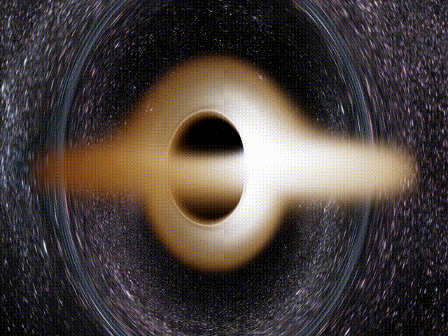

# Gargantua - Kerr Black Hole Ray Tracer

Gargantua is a CUDA ray tracer for rotating Kerr black holes. It integrates
null geodesics backward from the camera through curved spacetime until each ray
hits the accretion disk, falls through the event horizon, or escapes to a
gravitationally lensed star map.

The renderer supports volumetric disk glow, relativistic Doppler beaming,
gravitational redshift, HDR output, orbit animations, and an interactive browser
viewer backed by the same CUDA binary.



[Watch the MP4 render](gargantua.mp4) or inspect a still frame at
[gargantua_real.png](gargantua_real.png).

## Highlights

- **Kerr spacetime:** Boyer-Lindquist coordinates with `G = c = M = 1`.
- **Physical lensing:** backward null-geodesic integration with an adaptive
  Cash-Karp RKF45 solver.
- **Correct local camera frame:** a ZAMO orthonormal tetrad captures frame
  dragging near the black hole.
- **Accretion disk models:** volumetric emission/absorption for a soft glow, or
  a faster thin-disk crossing mode.
- **Relativistic color and brightness:** Doppler/gravitational frequency shift,
  `g^4` beaming, Planck blackbody emission, CIE color matching, ACES tonemapping,
  and optional HDR export.
- **Real sky backgrounds:** equirectangular Radiance HDR or binary PPM star maps
  are lensed by the ray directions.
- **Interactive control surface:** a Vite/Three.js viewer can request physical
  CUDA preview and final renders from a local API.
- **One-process animation mode:** full orbit sequences reuse GPU allocations,
  blackbody LUTs, and star-map textures across frames.

## Requirements

- NVIDIA GPU with CUDA support
- CUDA Toolkit
- CMake 3.20 or newer
- C++17-capable host compiler
- Optional: Node.js 18.19+ and npm for the browser viewer
- Optional: `ffmpeg` for MP4 animation encoding

## Quick Start

Build the renderer from the repository root:

```bash
cmake -S . -B build -DCMAKE_CUDA_ARCHITECTURES=120
cmake --build build -j
```

Render a default 1280x720 PNG:

```bash
./build/gargantua
```

Render a higher-quality still with the included Milky Way background:

```bash
./build/gargantua --width 1920 --height 1080 --spp 16 \
  --starmap milkyway.ppm --sky-bright 1.3 \
  -o gargantua_real.png --hdr gargantua_real.hdr
```

> **CUDA architecture:** replace `120` with your GPU compute capability if
> needed, for example `86` for RTX 30-series or `89` for RTX 40-series. Explicit
> architecture selection is more reliable than `native` on very new GPUs.

## Interactive Viewer

The `viewer/` app combines a Three.js navigation scene with a local render API
that launches `../build/gargantua` for physically accurate preview and final
frames.

From the repository root:

```bash
npm --prefix viewer install
npm --prefix viewer run dev
```

Open the Vite URL printed by the command, usually `http://127.0.0.1:5173`.
The API runs on `127.0.0.1:8787` by default.

Useful overrides:

```bash
GARGANTUA_BIN=/absolute/path/to/gargantua npm --prefix viewer run api
RENDER_API_PORT=8787 npm --prefix viewer run dev
```

If your terminal is already inside `viewer/`, use:

```bash
npm install
npm run dev
```

## Animation

Render an orbiting fly-around and encode it as MP4:

```bash
./render_animation.sh 240 1920 1080 12 30
```

Arguments are `frames width height spp fps`. The script renders PNG frames into
`frames/`, then encodes `gargantua.mp4` with `ffmpeg`.

For direct control from the renderer, use animation mode:

```bash
./build/gargantua --frames 120 --anim-dir frames \
  --width 1280 --height 720 --spp 4 \
  --cam-theta 86 --orbit-theta-amp 5 \
  --orbit-r0 70 --orbit-r1 46 \
  --starmap milkyway.ppm
```

## Command-Line Options

```text
--width N             image width
--height N            image height
--spp N               samples per pixel
--spin A              Kerr spin a/M in [0,1)
--cam-r R             camera radius in M
--cam-theta DEG       camera polar angle; 90 = edge-on
--cam-phi DEG         camera azimuth
--fov DEG             horizontal field of view
--yaw DEG             camera aim yaw offset
--pitch DEG           camera aim pitch offset
--disk-in R           inner disk radius; <0 = ISCO
--disk-out R          outer disk radius
--disk-temp K         inner-edge temperature
--disk-bright X       emission scale
--disk-noise X        disk turbulence strength, 0..1
--disk-thick X        volumetric disk scale height in M
--disk-flare X        scale-height flaring
--disk-absorb X       disk opacity coefficient
--thin                use the faster non-volumetric thin disk
--no-doppler          disable Doppler and gravitational frequency shift
--no-disk             hide the accretion disk
--starmap FILE        equirectangular HDR/PPM background map
--sky-bright X        star-map brightness scale
--exposure X          exposure before tonemapping
--tol X               adaptive integrator tolerance
-o FILE               output PNG path
--hdr FILE            also write linear Radiance HDR output
--frames N            render an animation sequence
--anim-dir DIR        animation frame output directory
--orbit-r0 R          animation dolly start radius
--orbit-r1 R          animation dolly end radius
--orbit-theta-amp D   animation inclination bob amplitude
```

Run `./build/gargantua --help` for defaults from the current `RenderConfig`.

## Recreate the Interstellar Look

The film-inspired look is intentionally more symmetric and pale gold, so this
example disables Doppler asymmetry:

```bash
./build/gargantua --spin 0.6 --cam-theta 87 --disk-temp 6500 \
  --no-doppler --spp 16 --starmap milkyway.ppm \
  -o gargantua_film.png
```

For a more physically honest version, keep Doppler enabled and use a high spin:

```bash
./build/gargantua --spin 0.99 --cam-theta 85 --disk-temp 12000 \
  --spp 16 --starmap milkyway.ppm \
  -o gargantua_physical.png
```

## Physics and Rendering Model

| Area | Implementation |
| --- | --- |
| Spacetime | Kerr metric in Boyer-Lindquist coordinates |
| Ray path | Backward null-geodesic integration |
| Geodesic solver | Hamiltonian formulation with conserved `E = -p_t` and `L = p_phi` |
| Metric derivatives | Analytic inverse-metric gradient for `d(2H)/dr` and `d(2H)/dtheta` |
| Integrator | Adaptive Cash-Karp RKF45 with error control |
| Camera frame | ZAMO locally non-rotating tetrad |
| Event horizon | `r+ = M + sqrt(M^2 - a^2)`; captured photons form the shadow |
| Disk inner edge | Prograde equatorial ISCO computed from spin `a` |
| Thick disk | Gaussian vertical density profile with emission/absorption volume integration |
| Thin disk | Single equatorial crossing inside `[r_in, r_out]` |
| Redshift | Frequency ratio `g = nu_obs / nu_emit`; brightness scales as `g^4` |
| Color | Planck spectrum integrated against analytic CIE 1931 color matching functions |
| Output | ACES tonemap, sRGB gamma, PNG writer, optional Radiance HDR writer |

## Star Maps and Assets

Use `--starmap` with a 2:1 equirectangular all-sky image. Supported formats:

- **Radiance HDR** (`.hdr` / `.pic`) for linear high-dynamic-range radiance.
- **Binary PPM** (`.ppm`, P6) for zero-dependency 8-bit sRGB loading.

Examples:

```bash
./build/gargantua --starmap milkyway.ppm --sky-bright 1.3 --spp 8 \
  -o gargantua_real.png --hdr gargantua_real.hdr

convert milkyway.jpg milkyway.ppm
convert milkyway.exr milkyway.hdr
```

If no star map is provided, escaped rays render as black sky.

## Project Layout

```text
include/config.h             Shared render configuration
src/main.cu                  CLI, validation, still render, animation setup
src/render.h                 Host render API declarations
src/render_kernel.cu         Disk model, redshift, CUDA kernels, frame rendering
src/spacetime.cuh            Kerr metric, geodesic RHS, RKF45, ZAMO tetrad, ISCO
src/blackbody.cuh            Planck/CIE LUT, tonemapping, quantization
src/starfield.cuh            Equirectangular texture sampling
src/star_map.h               HDR/PPM star-map loader
src/png_writer.h             Dependency-free PNG writer
src/hdr_writer.h             Radiance HDR writer
src/vec_math.cuh             Vector helpers and real-number precision type
render_animation.sh          Fly-around render and ffmpeg encode script
viewer/                      Browser viewer and local render API
viewer/src/BlackHoleScene.ts Three.js navigation scene
viewer/server/render-server.mjs Local API that launches the CUDA renderer
```

## Accuracy Notes

- Geodesic integration uses double precision by default.
- The adaptive solver reports the worst step error for rendered frames.
- Thick-disk redshift is evaluated at the segment midpoint polar angle, while
  thin-disk hits use the equatorial crossing.
- The renderer computes lensing, ISCO, redshift, and beaming from the metric;
  brightness, temperature, exposure, turbulence, and sky brightness remain
  artistic controls.
